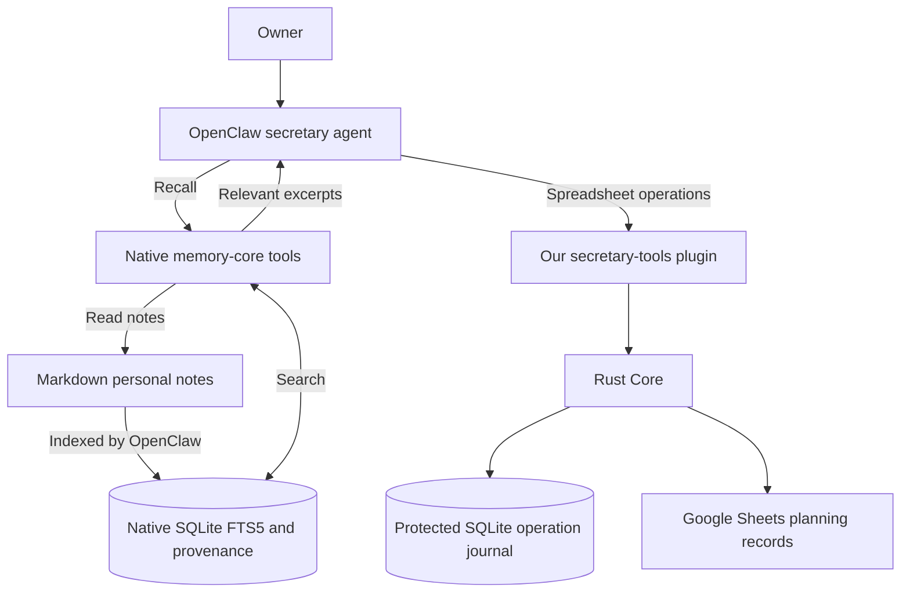
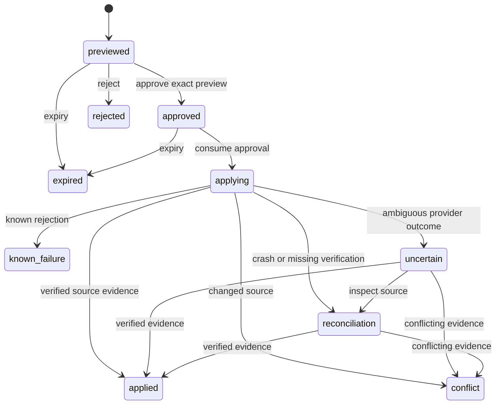

# Architecture and evidence

WhatsApp → OpenClaw Secretary Agent → bounded TypeScript tool plugin → authenticated loopback Rust Core → approved Google Sheets registry. One agent uses five domain Skills. Rust owns mappings, deterministic arithmetic, immutable previews, approval consumption, the operation journal and reconciliation. Sheets remains authoritative for planning records; the native OpenClaw scheduler remains authoritative for jobs.

The bridge derives the requester from trusted tool factory context rather than tool arguments. Current documented SDK `defineToolPlugin` ordinary execute has no actor field; runtime factories expose `requesterSenderId`, `senderIsOwner` and an invocation guard. Approval hooks require a mixed plugin entry. [Pinned v2026.10.7 factory source](https://github.com/openclaw/openclaw/blob/v2026.10.7/src/plugin-sdk/tool-plugin.ts) and [tool context](https://github.com/openclaw/openclaw/blob/v2026.10.7/src/plugins/tool-types.ts) ground these boundaries; actual installed package activation remains a separate check.

Native scheduler integration uses supported `cron.*` Gateway RPC through `api.runtime.gateway.request`, with caller scope enforced by the host. There is no presumed `runtime.cron` object and no custom scheduler or native-state editing. Job execution, provider acceptance and delivery evidence remain separate. [Pinned runtime](https://github.com/openclaw/openclaw/blob/v2026.10.7/src/plugins/runtime/types.ts) and [wire schema](https://github.com/openclaw/openclaw/blob/v2026.10.7/packages/gateway-protocol/src/schema/cron.ts) are interface evidence, not live compatibility proof.

Personal memory is delegated to OpenClaw by owner decision. The secretary plugin owns no personal-memory tools, lifecycle adapter or preference store; native lifecycle implementation is outside plugin scope. OpenClaw's selected facility and effective host policy determine native memory capabilities. The secretary continues to retrieve financial/planning facts from Sheets and keeps its operation journal separate.

For the owner's low-CPU/low-token priority, the local template uses the existing native Memory Core facility with `memory.search.provider: "none"`, no embedding fallback, and three primary-memory search results by default. Markdown remains the readable personal-note source; native SQLite holds its search index and provider-owned metadata. JSON remains configuration/interchange. Core's separate protected SQLite journal stores operation intent, approval and audit state, not a second personal knowledge store. [Pinned builtin memory engine](https://github.com/openclaw/openclaw/blob/v2026.10.7/docs/concepts/memory-builtin.md), [pinned memory configuration](https://github.com/openclaw/openclaw/blob/v2026.10.7/docs/reference/memory-config.md).

This reduces retrieval work by avoiding embedding generation; actual CPU/token savings are unmeasured. Keep automatically loaded USER.md/MEMORY.md compact and retrieve bounded relevant excerpts. The three-result setting is a default, not a hard token limit: per-call overrides and wiki/combined searches have different rules. Keyword matching also has weaker paraphrase recall than semantic retrieval. Native host permissions/privacy still require qualification; custom memory mutation is outside plugin scope.



The secretary plugin registers only its 17 spreadsheet/report/reminder tools. The two SQLite stores have different responsibilities and permissions. Native memory state belongs to OpenClaw; the secretary does not edit its tables directly. Core's journal belongs to controlled business operations. Personal notes cannot authorize spreadsheet writes. Native memory recall is available only when the actual provider and run policy admit it; the diagram is the intended integration, not evidence of an activated host.

[Interface notes](../contracts/interface-notes.md) define the implementation boundary. [Specification](specs/openclaw-personal-secretary.md) and [workbook assessment](spreadsheet-assessment.md) retain source decisions. The local ticket graph records completed checks and unresolved T007 live activation evidence. The subsequent low-effort review and its two local fixes are recorded in T009.

## Rust layers and command dispatch

The owner confirmed retaining the lightweight FSM + command bus architecture after discussing CQRS. [ADR0001](adr/0001-lightweight-command-bus-and-operation-fsm.md) records the scope and trade-off.

The Core follows the owner's DDD and hexagonal direction. Domain rules describe immutable change previews, source mappings, field validation, cost groups, exact arithmetic and legal operation transitions. Application code coordinates these rules through a typed in-process command bus. Infrastructure implements source and durable-operation ports. Presentation authenticates HTTP callers, decodes strict input, dispatches commands and maps domain errors into the existing JSON/status contract.

```text
presentation/http.rs → application/CommandBus → domain rules
                               ↓
                    SpreadsheetPort / OperationStore
                               ↑
                 infrastructure/GoogleClient / Journal
```

`domain/` and `application/` do not import Axum, Reqwest, SQLx or concrete infrastructure. `main.rs` is the composition root. `lib.rs` retains old module re-exports for adapter callers; new code should use the layer paths. The application owns generated record identities and preview expiry inputs. Presentation owns Core/operator bearer credentials; domain and application receive no caller-selected actor or approval proof.

The bus dispatches typed commands directly to handlers and awaits their results. `Command` denotes a typed application request here, so it includes reads. `MutationCommand::History` is grouped with the mutation coordinator for operation-history access; it does not execute a spreadsheet mutation. Reads also use this entry point; there is no asynchronous queue, broker, event sourcing or separate read store. One mutation coordinator still serializes preview/approval/apply work; adding the command bus does not make Sheets transactional. Ports return bounded source snapshots and operation outcomes. The source snapshot remains a JSON grid document for the existing schema mappings; a replacement provider must adapt to that document shape. This is a deliberately narrow migration rather than a new arbitrary spreadsheet abstraction.

## Operation state machine

`domain/operation.rs` owns `OperationState`, `OperationEvent`, outcome types, digest checks, expiry decisions and legal transitions. The SQLite adapter persists these decisions atomically with audit events. A shared RAII ownership guard releases its file lock explicitly only when the last application Journal handle drops; transient inherited descriptors cannot prolong ownership, and a live Journal clone still excludes another owner (T022). Persisted names and preview JSON stay compatible with the existing journal, so this refactor needs no schema migration.



An uncertain/reconciling operation cannot enter `applying` again or become `known_failure` merely because evidence is absent. Terminal states cannot be rewritten into a new attempt. Idempotent approval decisions remain supported. Startup moves interrupted applying operations to reconciliation without resending them. This is a durable operation FSM, not an event-sourced workflow engine.

T010 records actual validation and its limits. In-process Axum requests exercise the real presentation and command handlers with an external source-port fixture and real SQLite; they do not establish real HTTP transport, OAuth or Google compatibility.

## SDK authoring and local qualification

The plugin entry uses the actual OpenClaw 2026.10.7 `defineToolPlugin` public interface, static TypeBox tool/config schemas and invocation context factories. Bridge instances are created lazily per host API; metadata loading does not read credentials. Extending the original entry register function preserves SDK authoring metadata while attaching the native approval hook. Strict SDK type checking, host build/validate/pack, the full Rust dependency graph and real bridge/Core HTTP with Google-only simulation passed in T017. Live host activation, scheduler persistence, approval routing and delivery remain T007. See [local verification](local-verification.md).

The bridge's transient approval cache is bounded per host API: at most 64 captured previews and 4 MiB of serialized UTF-8 JSON. Preview capture/approval preparation prune expired entries; a new capture evicts oldest captured entries as needed, and re-fetching refreshes recency. Eviction requires a new preview before opening a dialog, without deleting Core's durable operation history. Already-open dialogs retain their own immutable one-shot snapshot and are outside this cache budget. No timer, persistent preference store or additional memory database is introduced. The byte budget bounds serialized cache data, not exact process heap usage (T020).
