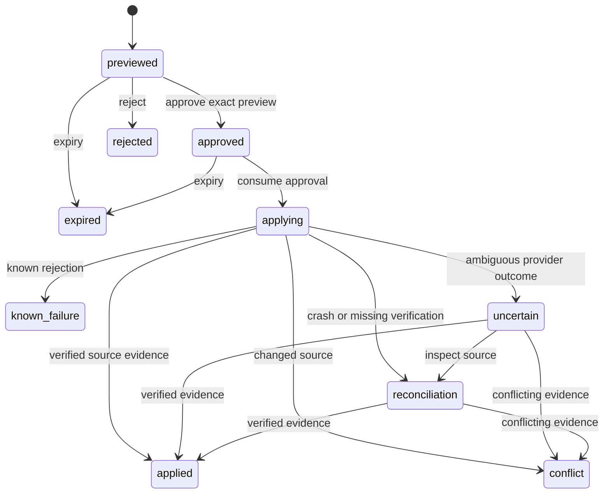

# Architecture and evidence

WhatsApp → OpenClaw Secretary Agent → bounded TypeScript tool plugin → authenticated loopback Rust Core → approved Google Sheets registry. One agent uses five domain Skills. Rust owns mappings, deterministic arithmetic, immutable previews, approval consumption, the operation journal and reconciliation. Sheets remains authoritative for planning records; the native OpenClaw scheduler remains authoritative for jobs.

The bridge derives the requester from trusted tool factory context rather than tool arguments. Current documented SDK `defineToolPlugin` ordinary execute has no actor field; runtime factories expose `requesterSenderId`, `senderIsOwner` and an invocation guard. Approval hooks require a mixed plugin entry. [Pinned v2026.10.7 factory source](https://github.com/openclaw/openclaw/blob/v2026.10.7/src/plugin-sdk/tool-plugin.ts) and [tool context](https://github.com/openclaw/openclaw/blob/v2026.10.7/src/plugins/tool-types.ts) ground these boundaries; actual installed package activation remains a separate check.

Native scheduler integration uses supported `cron.*` Gateway RPC through `api.runtime.gateway.request`, with caller scope enforced by the host. There is no presumed `runtime.cron` object and no custom scheduler or native-state editing. Job execution, provider acceptance and delivery evidence remain separate. [Pinned runtime](https://github.com/openclaw/openclaw/blob/v2026.10.7/src/plugins/runtime/types.ts) and [wire schema](https://github.com/openclaw/openclaw/blob/v2026.10.7/packages/gateway-protocol/src/schema/cron.ts) are interface evidence, not live compatibility proof.

The native memory lifecycle is unresolved. Ordinary Markdown search/get does not establish bounded save/update/archive/history with explicit consent or prevent automatic persistence. Do not silently replace native memory with a separate personal database.

[Interface notes](../contracts/interface-notes.md) define the implementation boundary. [Specification](specs/openclaw-personal-secretary.md) and [workbook assessment](spreadsheet-assessment.md) retain source decisions. The local ticket graph records completed checks and unresolved T007 live activation evidence. The subsequent low-effort review and its two local fixes are recorded in T009.

## Rust layers and command dispatch

The Core follows the owner's DDD and hexagonal direction. Domain rules describe immutable change previews, source mappings, field validation, cost groups, exact arithmetic and legal operation transitions. Application code coordinates these rules through a typed in-process command bus. Infrastructure implements source and durable-operation ports. Presentation authenticates HTTP callers, decodes strict input, dispatches commands and maps domain errors into the existing JSON/status contract.

```text
presentation/http.rs → application/CommandBus → domain rules
                               ↓
                    SpreadsheetPort / OperationStore
                               ↑
                 infrastructure/GoogleClient / Journal
```

`domain/` and `application/` do not import Axum, Reqwest, SQLx or concrete infrastructure. `main.rs` is the composition root. `lib.rs` retains old module re-exports for adapter callers; new code should use the layer paths. The application owns generated record identities and preview expiry inputs. Presentation owns Core/operator bearer credentials; domain and application receive no caller-selected actor or approval proof.

The bus dispatches typed commands directly to handlers and awaits their results. Reads also use this entry point; there is no asynchronous queue, broker, event sourcing or separate read store. One mutation coordinator still serializes preview/approval/apply work; adding the command bus does not make Sheets transactional. Ports return bounded source snapshots and operation outcomes. The source snapshot remains a JSON grid document for the existing schema mappings; a replacement provider must adapt to that document shape. This is a deliberately narrow migration rather than a new arbitrary spreadsheet abstraction.

## Operation state machine

`domain/operation.rs` owns `OperationState`, `OperationEvent`, outcome types, digest checks, expiry decisions and legal transitions. The SQLite adapter persists these decisions atomically with audit events. Persisted names and preview JSON stay compatible with the existing journal, so this refactor needs no schema migration.



An uncertain/reconciling operation cannot enter `applying` again or become `known_failure` merely because evidence is absent. Terminal states cannot be rewritten into a new attempt. Idempotent approval decisions remain supported. Startup moves interrupted applying operations to reconciliation without resending them. This is a durable operation FSM, not an event-sourced workflow engine.

T010 records actual validation and its limits. In-process Axum requests exercise the real presentation and command handlers with an external source-port fixture and real SQLite; they do not establish real HTTP transport, OAuth or Google compatibility.
